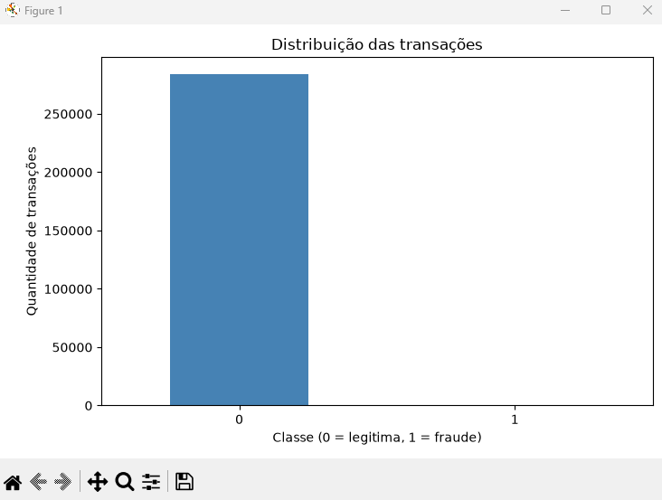
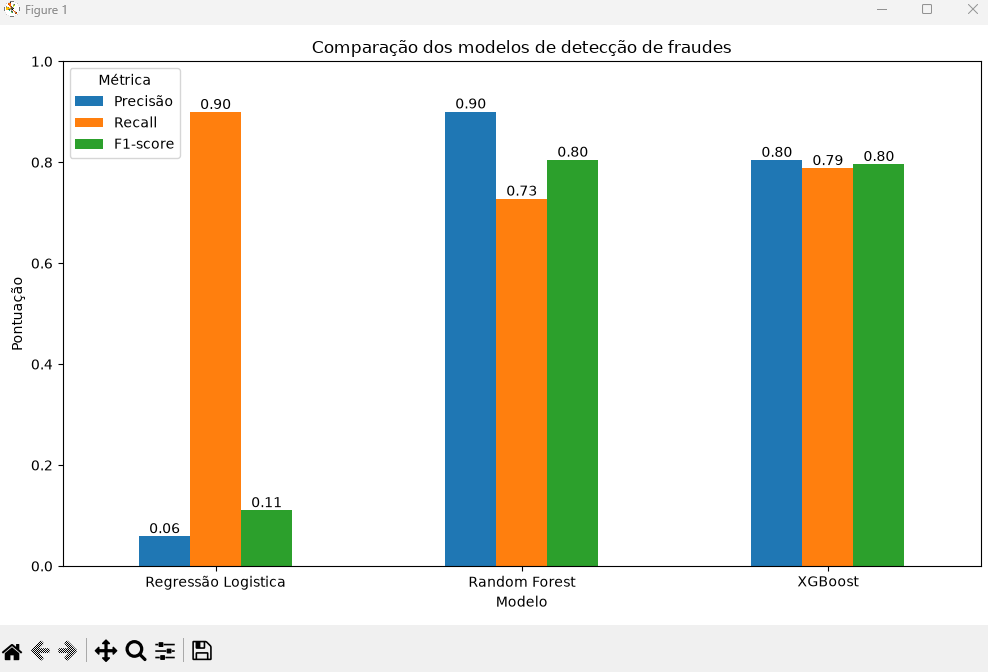
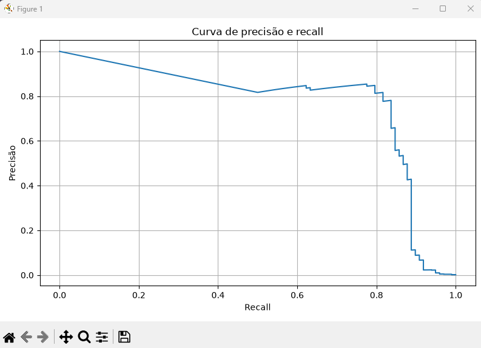
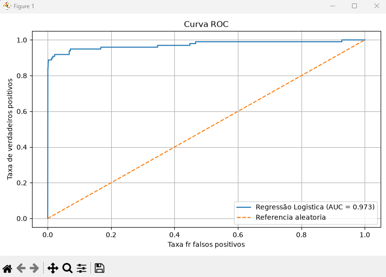
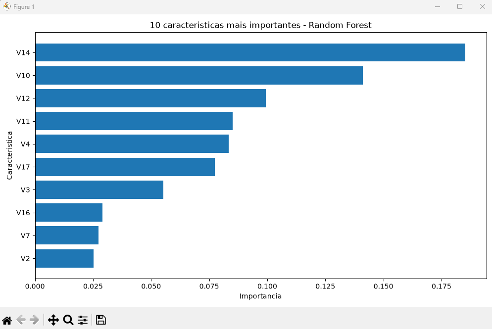
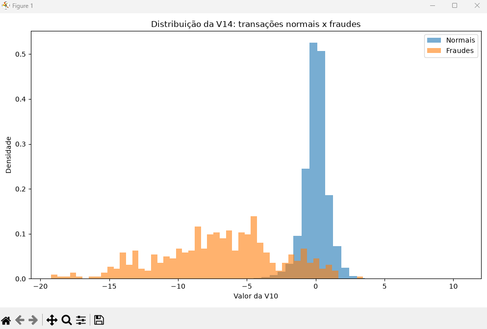

# 💳 Detecção de Fraudes em Cartões de Crédito

Projeto de Machine Learning desenvolvido em Python para identificar transações potencialmente fraudulentas em cartões de crédito.

O objetivo foi explorar os dados, treinar diferentes algoritmos de classificação e comparar seus resultados utilizando métricas adequadas para um problema de classes desbalanceadas.

## 📌 Sobre o projeto

O conjunto de dados utilizado contém **284.807 transações**, sendo:

- 284.315 transações legítimas (99,83%).
- 492 transações fraudulentas (0,17%).

Esse desequilíbrio representa um desafio: um modelo poderia apresentar alta acurácia simplesmente classificando quase todas as transações como legítimas.

Por isso, foram utilizadas métricas como Precision, Recall, F1-score e ROC-AUC.

## 🛠️ Tecnologias utilizadas

- Python
- Pandas
- NumPy
- Matplotlib
- Scikit-learn
- XGBoost

## 📂 Estrutura do projeto

```text
deteccao-fraude-cartao/
│
├── data/
│   └── creditcard.csv
│
├── images/
│   ├── distribuicao-transacoes.png
│   ├── curva-precision-recall.png
│   ├── curva-roc.png
│   ├── importancia-caracteristicas.png
│   ├── distribuicao-v10.png
│   └── comparacao-modelos.png
│
├── main.py
├── README.md
├── requirements.txt
└── .gitignore
```

A pasta `.venv` é utilizada localmente e não é enviada ao GitHub.

## 🔎 Etapas do desenvolvimento

1. Importação e exploração dos dados.
2. Análise da distribuição das classes.
3. Análise estatística dos valores das transações.
4. Aplicação da transformação logarítmica na variável `Amount`.
5. Separação dos dados em treino, validação e teste.
6. Padronização das variáveis para a Regressão Logística.
7. Treinamento de três modelos de Machine Learning.
8. Comparação dos modelos utilizando métricas de classificação.
9. Análise da importância das características.
10. Avaliação final do modelo selecionado.

## 📊 Análise exploratória

A distribuição das classes demonstra o forte desequilíbrio entre transações legítimas e fraudulentas.



## 🤖 Modelos de Machine Learning

Foram treinados e comparados três algoritmos:

- **Regressão Logística:** modelo de classificação utilizado como primeira abordagem.
- **Random Forest:** algoritmo baseado em múltiplas árvores de decisão.
- **XGBoost:** algoritmo de boosting baseado em árvores de decisão.

## 📈 Comparação dos modelos

Resultados obtidos no conjunto de validação:

| Modelo | Precisão | Recall | F1-score |
|---|---:|---:|---:|
| Regressão Logística | 0,059 | 0,899 | 0,110 |
| Random Forest | 0,900 | 0,727 | 0,804 |
| XGBoost | 0,804 | 0,788 | 0,796 |



O Random Forest apresentou o maior F1-score na validação, enquanto o XGBoost apresentou recall ligeiramente superior à precisão e ao recall do Random Forest.

## 🎯 Avaliação do modelo final — Random Forest

Após a comparação dos modelos, o Random Forest foi selecionado para a avaliação final no conjunto de teste.

| Métrica | Resultado |
|---|---:|
| Precisão (Precision) | 90% |
| Recall | 81,6% |
| F1-score | 85,6% |
| ROC-AUC | 0,9519 |

### Matriz de confusão

| Resultado | Quantidade |
|---|---:|
| Verdadeiros negativos | 56.855 |
| Falsos positivos | 9 |
| Falsos negativos | 18 |
| Verdadeiros positivos | 80 |

O modelo identificou **80 das 98 fraudes** presentes no conjunto de teste.

## 📉 Curvas de avaliação

A curva Precision-Recall permite observar a relação entre precisão e recall conforme o limiar de classificação varia.



A curva ROC apresentada abaixo corresponde à Regressão Logística, com AUC de 0,973.



## 🔍 Importância das características

A análise de importância do Random Forest destacou as seguintes variáveis:

1. V14
2. V10
3. V12
4. V11
5. V4
6. V17
7. V3
8. V16
9. V7
10. V2



Também foi analisada a distribuição da variável V10 entre transações legítimas e fraudulentas.



Essas análises ajudam a compreender quais características contribuíram mais para as decisões do modelo.

## ▶️ Como executar o projeto

### 1. Clonar o repositório

```bash
git clone https://github.com/Israeldevelop/python-deteccao-fraude-cartao.git
```

### 2. Entrar na pasta

```bash
cd python-deteccao-fraude-cartao
```

### 3. Criar um ambiente virtual

```bash
python -m venv .venv
```

### 4. Ativar o ambiente virtual no Windows

```powershell
.venv\Scripts\Activate
```

### 5. Instalar as dependências

```bash
pip install -r requirements.txt
```

### 6. Baixar a base de dados

O arquivo `creditcard.csv` deve ser baixado e colocado dentro da pasta `data`.

[Baixar a base de dados — Credit Card Fraud Detection](https://storage.googleapis.com/download.tensorflow.org/data/creditcard.csv)

### 7. Executar o projeto

```bash
python main.py
```

## 📝 Conclusão

O projeto permitiu aplicar conceitos de análise de dados e Machine Learning em um problema real de classificação com forte desequilíbrio entre classes.

A comparação entre Regressão Logística, Random Forest e XGBoost demonstrou como diferentes algoritmos apresentam comportamentos distintos em relação à precisão e à identificação de fraudes.

O Random Forest apresentou o melhor F1-score na validação e alcançou 85,6% de F1-score na avaliação final.

Este projeto foi desenvolvido como prática de estudos em Python, análise de dados e Machine Learning.

---

**Desenvolvido por Israeldevelop**